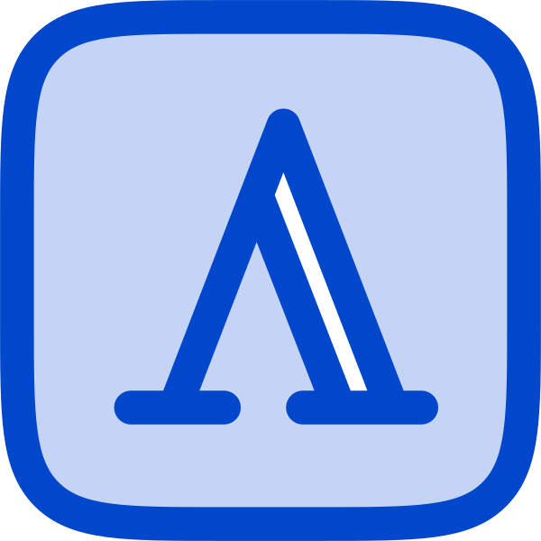
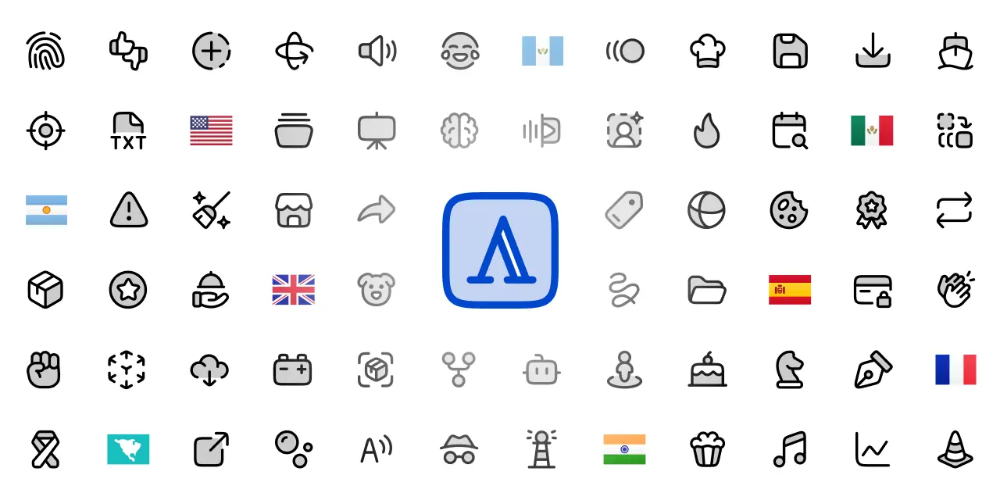

# andrsrxn/icons

 

React icon library with 2,500+ duotone icons and 250+ flags.
 
Smooth, RTL-aware, and optimized SVGs.

[Documentation](https://icons.andrsrxn.com/docs) • [Figma plugin](https://www.figma.com/community/plugin/1682600602773496009) • [npm](https://www.npmjs.com/package/@andrsrxn/icons)

## Overview

`andrsrxn/icons` is an open-source duotone icon library designed on Figma and built for modern React applications. The set is lightweight, visually consistent, and accessible.

### Why another icon library?

The short answer: **there are no free duotone icon sets with the right style**.

Most libraries only offer outline or solid variants, some duotone implementations applies an extra layer to every icon unconditionally, this results in unnecessary visual noise and icons that feel semantically inconsistent.

`andrsrxn/icons` takes a more deliberate approach:

- **Duotone by default**: Icons that have a meaningful path/fill distinction are always duotone.
- **Outline when appropriate**: Simple geometric icons such as `+`, `/`, or `×` do not receive a decorative background layer that would only reduce clarity.
- **Filled on demand**: A `filled` variant is included only for icons that have a meaningful active or selected state, such as `like`, `bookmark`, or `star`, not as a blanket alternative style.

## Groups

- **UI**: Duotone icons for apps, each with its own preview image. (aspect ratio 1:1)
- **Flags**: Simple and minimal country flags, named with ISO 3166-1 alpha-2 code (`IconFlagGT`, `IconFlagUS`), the exceptions are `IconFlagLGTB` and continent flags, which have a `C` prefix (`IconFlagCAF` for Africa, `IconFlagCNA` for North America, and so on); treated as image assets with country code as `aria-label` included. (aspect ratio 3:2)

> **Notice**: We do not provide any brand or logo icons, as we are purely an icon library. If you need such icons, we recommend checking out [SVGL](https://svgl.app), [theSVG](https://thesvg.org), or [Simple Icons](https://simpleicons.org).

## Documentation

[See full documentation](https://icons.andrsrxn.com)

## Contributing

We currently do not accept contributions for new icons, but we appreciate suggestions and icon requests through [GitHub issues](https://github.com/andrsrxn/icons/issues/new?template=icon-request.yml).

## Support

If this project is useful to you, consider supporting its development through:

- [GitHub Sponsors](https://github.com/sponsors/andrsrxn)
- [Credit/Debit card](https://app.recurrente.com/s/andrsrxn/pagar)
- [PayPal](https://paypal.me/andrsrxn)

## Inspiration

All of the icons were made by scratch on Figma but inspired on the following icon libraries:

- [Phosphor Icons](https://phosphoricons.com/)
- [HugeIcons](https://hugeicons.com/icons)

## Credits

The flag icons are adapted from [FlagKit](https://github.com/madebybowtie/FlagKit) by [Bowtie](https://github.com/madebybowtie), used under the MIT License (Copyright (c) 2016 Bowtie AB). Only the 3:2 rectangular flag versions were used as source material and converted into `tsx` components. See [THIRD-PARTY-LICENSES.md](./packages/icons/THIRD-PARTY-LICENSES.md) for the full license text.

## License

All icons are free; personal or commercial use is allowed under [MIT License](./packages/icons/LICENSE) - Copyright 2026 Andrés Raxón (andrsrxn).
